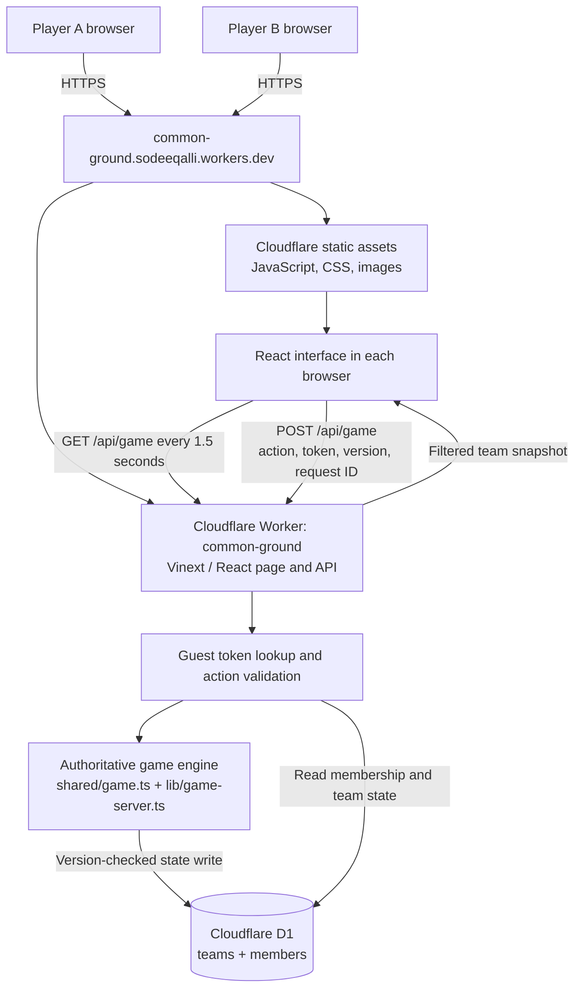
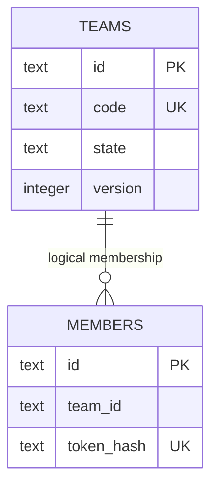
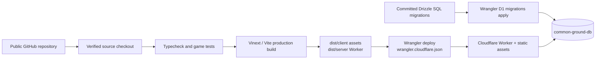

# Common Ground — system architecture

Verified against the application source and direct Cloudflare deployment on 8 November 2026.

## Deployment

The current public game is deployed directly in Sodeeq's own Cloudflare account. Its frontend assets, server-rendered page and backend API are deployed together; persistent game data lives in Cloudflare D1.

- **Public game URL:** https://common-ground.sodeeqalli.workers.dev
- **Worker:** `common-ground`; deployed version `147d3a71-b79a-4f1e-9c6b-f81381beedd2`.
- **Account:** `9c3da6d10da778ca7bc883341b0db1d5`.
- **Source:** https://github.com/Sodeeqalli/common-ground
- **Database:** `common-ground-db`, ID `eae92d8d-6f23-46be-ab16-b7049c4c3a80`, created in WNAM; binding `DB`; verified live user tables: `teams`, `members`.
- **Deployment configuration:** `wrangler.cloudflare.json`; this is distinct from the generated local/Sites configuration.
- **Local development:** `http://127.0.0.1:5173`; local data is separate from hosted data.

The earlier owner-private managed preview at `https://common-ground-htc2026.sodeeqalli.chatgpt.site` remains separate. This deployment created a fresh database; it did not copy local or managed-preview teams. Use the public URL above for teammates and judges. No custom domain or automatic GitHub deployment workflow was configured.

## Runtime diagram



The public deployment has no Sites access gate. Frontend and API use the same origin; application guest-token checks protect private team state and actions. D1 is accessed through the Worker's binding, not directly by browsers.

There are three logical layers—frontend, application backend and database—but no requirement for three separate websites or servers. Cloudflare supports deploying Worker code and static assets together. [Cloudflare Static Assets documentation](https://developers.cloudflare.com/workers/static-assets/)

## Components and responsibilities

| Layer | Implementation | Responsibility |
|---|---|---|
| Frontend | React 19, TypeScript, Vinext/Vite build | World picture, mission board, planning controls, signals, pings, optional chat and comfort settings |
| Hosting | Cloudflare Worker and static assets, deployed with Wrangler | HTTPS delivery, frontend asset serving, page rendering and API execution |
| API | `app/api/game/route.ts`, `/api/game` | Create/join teams, directory queries, authenticated reads, validate and persist actions |
| Game service | `lib/game-server.ts` | Permissions, phase transitions, requests, signals, chat and restoration credits |
| Deterministic engine | `shared/game.ts` | Maps, movement, energy, plate occupancy, gate crossings, collision rollback and success/failure |
| Durable storage | Cloudflare D1, `DB` binding | Membership credentials and each team's persistent state |
| Browser storage | `localStorage` | This browser's guest token and local presentation preferences; not authoritative world progress |

Vinext uses the React/Next-style application source structure with a Vite/Cloudflare build. This is not a separate Next.js Node server. The runtime game has no external AI model, WebSocket service, Redis, R2 file store or separate matchmaking service. Drizzle defines the schema and generated migration; the active game API uses D1 prepared statements directly.

## Data model



The relationship above is logical: the initial SQL does not declare a foreign-key constraint.

`teams.state` is one JSON document holding the team name and owner, roster, discoverability, restored regions, contributor snapshots, current attempt, signals, map pings, energy requests, recent messages and recent processed action IDs. The attempt contains the selected map, phase, round, robots, positions, movement histories, energy, routes and component status.

This document design keeps a successful mission and its world restoration/contributor credits in the same version-checked update. It also means each mutation rewrites a team document. That is a deliberate MVP simplification, with contention and document size to revisit if usage grows.

`members` maps a guest identity to a team and a SHA-256 hash of its random bearer token. The raw token is returned at creation/join and saved in that browser. It is not stored in D1 as plaintext. Tokens and database rows never belong in the public Git repository.

## One multiplayer action, end to end

1. A player queues a route or chooses an action in the React interface.
2. The client posts the action, current team version, mission/round/phase identifiers and a fresh request ID. Readiness actions also include a summary of the plan being accepted.
3. The Worker hashes the bearer token and looks up membership, then loads current team state.
4. The service checks permissions and the action's constraints: for example, only mission participants can move, the phase must allow it, and the route cannot exceed available energy.
5. The engine applies the action. When both routes are locked, it resolves them one step at a time. Plate arrivals/departures are resolved before gate-entry checks; route order does not let a player bypass a closed gate.
6. The API writes with `UPDATE ... WHERE version = ?`. A competing update cannot silently overwrite a teammate's accepted action. Safe independent actions can reload and revalidate; obsolete shared plans are rejected for review.
7. The response gives the acting player the accepted state. The other browser receives it through its next poll. Each response hides the other player's queued route and removes internal processed-request history.

Request IDs are remembered in a bounded recent list to prevent a duplicate submission from applying again. This is bounded retry protection, not a permanent event ledger. Mission success, region restoration and contributor attribution are committed together.

## Synchronization and recovery

- Clients poll every 1.5 seconds. This is near-real-time HTTP synchronization, not WebSockets; propagation can take a polling interval plus network time.
- Responses use `Cache-Control: no-store`. The client ignores an older snapshot if a newer version has already arrived.
- Accepted state persists in D1, so a reload can resume it. An unsent local route is not durable.
- All-ready barriers synchronize decision phases. There is no deadline for answering; finite rounds and energy create the strategic constraint.
- Either participant can confirm ending an attempt. Completed world progress remains saved, and another pair may start.
- There is one active attempt per team. Up to six members share the team; two participate in a new mission.
- “Connected” means this browser can reach the backend. It does not prove the partner is online. There is no heartbeat-based partner presence system.

## API and access boundaries

| Request | Access and returned data |
|---|---|
| `GET /api/game?view=discover&q=...` | Public directory; only opted-in teams with open places, exposing ID/name/member count |
| `POST` create/join/join-discovered | Issues a guest identity after validating the request and target team; no existing guest token needed |
| `GET /api/game` | Bearer token required; returns that member's filtered team view |
| `POST` mission/coordination/settings action | Bearer token required; validates membership, ownership or expedition role as appropriate |

Prepared SQL parameters, bounded request bodies, message-length validation, signal/ping throttles and server-side role checks are implemented. These do not constitute a full public-community abuse-prevention system. The MVP has no moderation service, guest account recovery, comprehensive endpoint rate limiting or automatic token expiry. Optional chat is a local display preference; enabling it is not a separate permission boundary from team membership.

Leaving on this device removes the local token; it does not delete the server member slot. Rejoining creates a new identity. Local, managed-hosted and direct-account D1 databases are distinct; this deployment did not migrate data between them.

## Build and deployment pipeline



The current workflow is an explicit Wrangler deployment from the verified checkout, not an automatically configured GitHub Actions pipeline. The schema is in `db/schema.ts`; committed SQL is under `drizzle/`. Wrangler applied `0000_spicy_wind_dancer.sql` to the new database and recorded it in `d1_migrations`. Future runs apply pending migrations; do not rewrite applied SQL or rerun the initial SQL manually. [D1 migrations documentation](https://developers.cloudflare.com/d1/reference/migrations/)

To redeploy from this repository with an authorized Wrangler session:

```sh
npm ci
npm run typecheck
npm test
npm run cloudflare:migrate
npm run cloudflare:deploy
```

`cloudflare:deploy` builds and uploads the Worker and frontend assets with the explicit direct-account config. `npm run cloudflare:check` performs a dry run against an existing build. Keep account/database IDs in configuration, but never commit OAuth credentials or API tokens. Anyone deploying to another account must provision their own D1 and change both IDs first. These commands target the public deployment; ordinary `npm run dev` remains local.

## Verification and limits

The final release checks are documented in [release-check.md](release-check.md): 38 rule tests, complete persisted wins through both maps, concurrent updates, identity/permission checks and a full two-browser Greenhouse run. Those were local production-build tests. The full API suite also passed using the direct deployment configuration against isolated local QA storage before release.

The public deployment was verified separately: Wrangler uploaded the Worker and 22-file asset set, the browser rendered both mission cards, Discover teams returned its successful empty-directory state, and remote D1 confirmed both application tables and the applied migration. The checked browser reported no console warnings/errors. Independent curl checks returned HTTP 200 for discovery and HTTP 401 for an unauthenticated private-state request, both with `Cache-Control: no-store`. A Python urllib probe received Cloudflare edge error 1010; normal browser and curl access succeeded. After the user explicitly authorized live test records, a complete eight-round Greenhouse mission also passed through two independent browser identities on production. Both clients showed 2/2 components and robots home; the restored greenhouse and both contributor names survived reloads. Strategy requests, Yes replies, energy transfer, pings and two-way optional chat were checked. See [live-multiplayer-check.md](live-multiplayer-check.md) for the exact scope and retained private QA records. Power station and broader failure/concurrency coverage remain local tests.

This architecture is sized for the hackathon MVP. Larger-scale work would consider measured polling load, contention between frequent team writes, account recovery, community moderation and stronger abuse controls. A WebSocket/Durable Object redesign is a possible later choice, not part of the implemented system or a requirement for demonstrating it.

## Thirty-second technical explanation

“The React frontend and API run as one Cloudflare Worker deployment with static assets. D1 stores team identity and saved world state. The server owns the game rules: it resolves both players' moves, opens gates from actual pressure-plate occupancy and saves success with both contributors. Clients poll for shared updates, while version checks and request IDs prevent concurrent actions from overwriting or repeating each other.”
